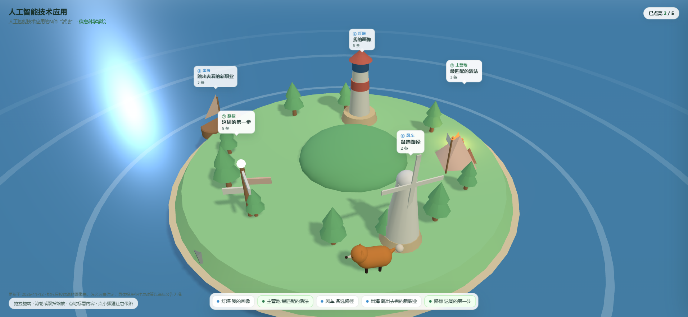
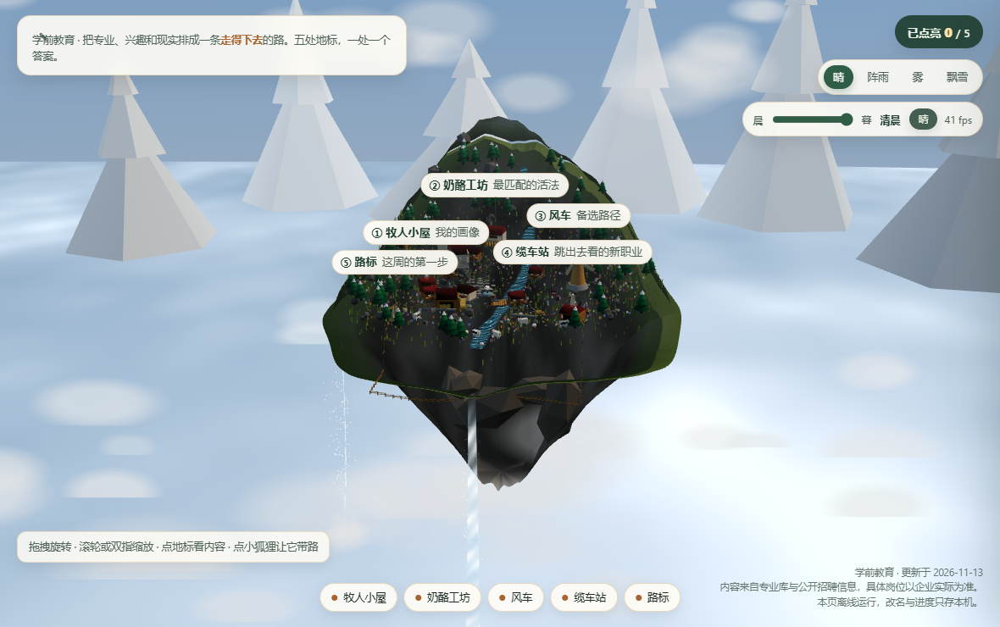
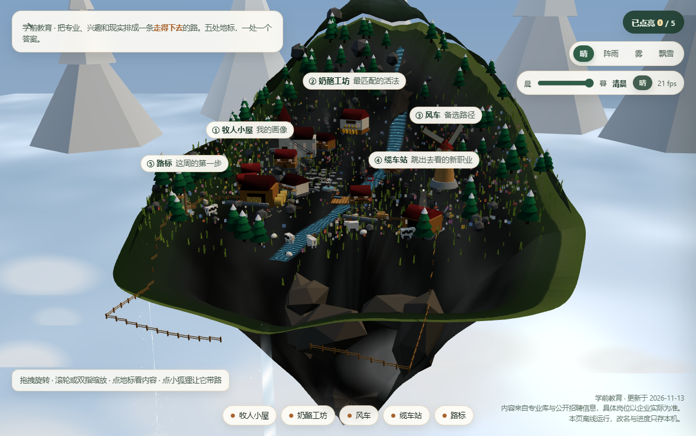

---
AIGC:
    Label: "1"
    ContentProducer: 001191440300708461136T1XGW3
    ProduceID: 78db55555203ac71c8a419c882a06031_e600dd1cdf2c11f1913b525400393706
    ReservedCode1: RBJLSfnKexKLd6N9jpMg8/zYzUa0rg+OsweETZ9ey5fq8ZxyYTgOPwYFhC86qSShz6Vmxpfr8IeDJfmwJ2Q0YXCuQNdMzn7LRJeFzkIMVKfLtqvhfhtjFaoWdobsrmNxXWmTPHTJidVeD0aeZCMk0yx65J61U/rPv1PFnVQsi5CPKa9858hmQw5XTnk=
    ContentPropagator: 001191440300708461136T1XGW3
    PropagateID: 78db55555203ac71c8a419c882a06031_e600dd1cdf2c11f1913b525400393706
    ReservedCode2: RBJLSfnKexKLd6N9jpMg8/zYzUa0rg+OsweETZ9ey5fq8ZxyYTgOPwYFhC86qSShz6Vmxpfr8IeDJfmwJ2Q0YXCuQNdMzn7LRJeFzkIMVKfLtqvhfhtjFaoWdobsrmNxXWmTPHTJidVeD0aeZCMk0yx65J61U/rPv1PFnVQsi5CPKa9858hmQw5XTnk=
---

# 专业的 N 种活法

> 输入一个专业名，生成该专业的多条职业路径（"活法"），并渲染成一座可以转、可以点、可以缩放的三维漫游页面 —— **我的职业探索岛**。

给 Marvis 装上这个 Skill，学生只需要像聊天一样答完六道选择题，就能拿到属于自己的《XX·职业探索岛》单文件 HTML，双击即开、断网可用。

---

## 做出来的页面长什么样

一座悬浮在云海之上的牧场小岛：圆盘岛台、草皮包边、收窄断崖、倒锥岩体，岛缘瀑布跌进云里，远处是雪峰与冷蓝天空。岛上有五个三维地标，每一处是一个入口；一只橙白小狐狸会环岛漫游，点它就会带路到下一个还没看过的地标。

| 全景（含小狐狸） | 全景核对视角 |
| --- | --- |
|  |  |

| 近景：地标标签与抽屉入口 |
| --- |
|  |

五个地标对应页面里的五个栏目：

| 地标 | 对应栏目 | 内容 |
| --- | --- | --- |
| ① 牧人小屋 | 我的画像 | 专业 / 阶段 / 想要的工作状态 / 兴趣 / 优势标签，以及"你说过的"原话 |
| ② 奶酪工坊 | 最匹配的活法 | 按画像打分排序的前 N 条（默认 3 条） |
| ③ 风车 | 备选路径 | 第 N+1 条起的备选活法（默认 2 条） |
| ④ 缆车站 | 跳出去看 | 与专业相关的新职业 3 条（来自 `assets/new-jobs.json`） |
| ⑤ 路标 | 这周的第一步 | 前几条活法的下一步动作汇总 |

交互层：拖拽旋转、滚轮 / 双指缩放、点击地标或标签开右侧抽屉、已点亮 N/5 计数、底部图例、页脚、开场指南卡、岛名 HUD（`✎` 可改名，`localStorage` 记住）、天气切换、WebGL 不可用时自动降级为五条文字版。

---

## 内置专业

覆盖福建幼儿师范高等专科学校 2026 级 **25 个在办专业**，共 **152 条活法**（学前教育 8 条，其余各 6 条），六类路径族全覆盖。

| 学院 | 专业 |
| --- | --- |
| 学前教育学院 | 学前教育、早期教育、特殊教育、婴幼儿托育服务与管理、食品营养与健康\* |
| 艺术教育学院 | 音乐教育、美术教育、艺术设计、工艺美术品设计、首饰设计与工艺、舞蹈表演\*、音乐传播\* |
| 人文科学学院 | 小学教育（综合文科教育）、小学科学教育、社会工作、智慧健康养老服务与管理、小学数学教育\* |
| 外语教育学院 | 小学英语教育、应用英语、研学旅行管理与服务 |
| 信息科学学院 | 现代教育技术、数字媒体技术、嵌入式技术应用、人工智能技术应用、开源技术应用\* |

\* 为 2026 年口径新增（依据学校 2026 年秋季收费公告与专业设置备案）。

另有 `assets/new-jobs.json`：**23 条新职业 / 8 个方向**（数字技术、内容创意、银发经济、文旅消费、民生服务、社区治理、绿色低碳、教育新形态），用作"专业之外的第二层"。

不在库的专业会报错并列出可用专业名；想扩校，只要按 `assets/majors/00-学前教育.json` 的字段结构新增一个 JSON 即可。

---

## 安装

在 Marvis 里把下面这段整句发给 Agent 即可：

```
请安装这个 Skill 并帮我制作职业探索岛：https://github.com/mmrlavender/major-ways-to-live
```

Agent 会把仓库下载解压到本机技能目录（`C:\Users\<用户名>\.marvis\skills\custom\major-ways-to-live\`）并登记为自定义 Skill，之后在技能列表中就能看到 `major-ways-to-live`。

也可以手动装：

1. 下载本仓库 ZIP 并解压；
2. 把整个 `major-ways-to-live` 目录放到 `C:\Users\<用户名>\.marvis\skills\custom\` 下；
3. 重启 Marvis，让对方用 `skill_install`（`local_paths` 指向该目录）完成登记。

> 仓库根即 Skill 根：`SKILL.md` 必须在顶层，`references/`、`assets/`、`scripts/` 保持同级。

---

## 使用

### 1. 对话式（学生侧零门槛）

直接说一句：

> 我想看看我这个专业以后能干什么

Agent 会按 `SKILL.md` 走六题访谈（专业 → 阶段 → 想要的工作状态 → 兴趣 → 优势 → 城市/升学/避开项），一轮一题，答完复述画像确认，然后生成岛屿页。

### 2. 命令行（老师 / 批量）

准备画像 JSON（`major` 必填）：

```json
{
  "major": "学前教育",
  "stage": "大二",
  "wantState": "稳定+有成长",
  "interests": ["和孩子打交道"],
  "strengths": ["耐心", "会做手工"],
  "city": "福州",
  "avoid": ["长期熬夜"],
  "islandName": "小星星",
  "says": ["我不想天天加班", "想留在福州"]
}
```

```bash
# 三维职业探索岛（默认：悬浮小岛牧场风）
node scripts/island.mjs --profile ./profile.json --out "./小星星-职业探索岛.html" --json

# 换岛名 / 换视觉
node scripts/island.mjs --profile ./profile.json --name "小星星"          # 岛名，自动补「·职业探索岛」
node scripts/island.mjs --profile ./profile.json --theme ocean             # 旧海洋岛视觉
node scripts/island.mjs --profile ./profile.json --flat 1                   # 二维 SVG 回退（老显卡最稳）

# 其他产出
node scripts/recommend.mjs --profile ./profile.json --out "./学前教育-我的N种活法.html"
node scripts/explore.mjs --out "./专业之外的新职业地图.html"
node scripts/explore.mjs --major "学前教育" --profile ./profile.json --out "./学前教育-新职业地图.html"
node scripts/build_page.mjs --data assets/majors/00-学前教育.json --out "./学前教育-专业的N种活法.html"
node scripts/build_all.mjs --data-dir assets/majors --out-dir "../major-ways"    # 全校 25 页 + index.html
```

`island.mjs` 参数：

| 参数 | 说明 |
| --- | --- |
| `--profile <json>` | 必填，画像文件 |
| `--out <html>` | 输出路径，省略则在当前目录按专业名生成 |
| `--top <n>` | "最匹配"条数，默认 3 |
| `--name <岛名>` | 岛名主体，优先级：`--name` > `profile.islandName` > 专业名兜底 |
| `--theme ranch\|ocean` | 视觉主题，默认 `ranch`（悬浮小岛牧场风） |
| `--flat 1`（或 `--style flat`） | 二维 SVG 岛屿回退 |
| `--json` | 把结果以 JSON 打到 stdout（含 `style`、`theme`、`island_name`） |

### 3. 退出码

| 退出码 | 含义 | 处理 |
| --- | --- | --- |
| `0` | 成功 | 正常拿到 HTML |
| `2` | 参数错误 / 模板缺失（stderr 会指出缺哪个模板） | 检查 `--profile` 路径、`assets/` 是否完整 |
| `3` | 专业不在库（stderr 带 `available` 专业列表） | 用列表里的标准专业名重试，或新增 `assets/majors/*.json` |

补充：`build_page.mjs` / `build_all.mjs` / `explore.mjs` 还有各自的 `1` / `4` 退出码（数据不合法、方向筛选为空等），stderr 的 JSON 里都有说明。

---

## 环境要求

| 项 | 要求 |
| --- | --- |
| Marvis | 必需，Skill 靠它加载 |
| Node.js | **20 LTS 及以上**，实测通过 v22.12.0、v26.13.1 |
| 依赖 | 无。脚本只用 `node:fs` / `node:path` / `node:url`，不需要 `npm install` |
| 浏览器 | 任意现代浏览器（三维需 WebGL；不可用时页面自动文字降级） |

没有 Node 也能对话、拿到活法结论，但生成不了 HTML 页面 —— 因为所有渲染脚本都是 Node 脚本。

---

## 目录结构

```
major-ways-to-live/
├── SKILL.md                          # 技能主文档：场景判断、访谈节奏、活法标准、版式契约、交付
├── references/
│   ├── interview.md                  # 六题访谈题面
│   ├── personalize.md                # 画像→排序→输出的规则
│   └── paths-framework.md            # 活法字段标准与六类路径族
├── assets/
│   ├── template.html                 # 海报风单页模板
│   ├── island-template.html          # 二维 SVG 岛屿模板（--flat）
│   ├── island-ranch-template.html    # 三维悬浮小岛牧场风模板（默认）
│   ├── island-3d-ocean-template.html # 旧海洋岛模板（--theme ocean）
│   ├── example-data.json             # 学前教育示例（8 条活法）
│   ├── new-jobs.json                 # 23 条新职业 / 8 方向
│   ├── majors/                       # 25 个专业数据，一专业一 JSON
│   └── vendor/three.min.js           # three@0.160.0 UMD，内联进页面（669,884 B）
├── scripts/
│   ├── island.mjs                    # 生成三维职业探索岛（默认产出）
│   ├── recommend.mjs                 # 生成海报风个性化页
│   ├── build_page.mjs                # 单专业通用页
│   ├── build_all.mjs                 # 全校批量 + index.html
│   └── explore.mjs                   # 新职业地图
├── docs/images/                      # README 预览图
├── LICENSE                           # MIT
└── .gitignore
```

产物是**单文件 HTML**：three.js 已内联，无任何外链，双击即可打开，方便直接发给学生或发到群里。

---

## 自检（装完 1 分钟验证）

```bash
node -v                                              # 应 ≥ v20
node scripts/island.mjs --profile ./profile.json --json
# 期望：ok:true, style:"3d", theme:"ranch", island_name:"小星星·职业探索岛"
ls assets/vendor/three.min.js                         # 669,884 字节
```

---

## 许可

- 本仓库的 Skill 结构、脚本、模板与文档采用 [MIT License](LICENSE)（Copyright (c) 2026 major-ways-to-live contributors），可自由使用、修改、分发，包括商业用途，保留版权与许可声明即可。
- 内置专业数据来自公开的学校招生与收费公告，仅作职业引导参考，不构成就业承诺。
- `assets/vendor/three.min.js` 为 three.js r160（MIT License），版权归 three.js 作者所有。
- 三维漫游观感参考了 [panggungunvibe/island-portfolio](https://github.com/panggungunvibe/island-portfolio)，感谢原作者。
*（内容由AI生成，仅供参考）*
